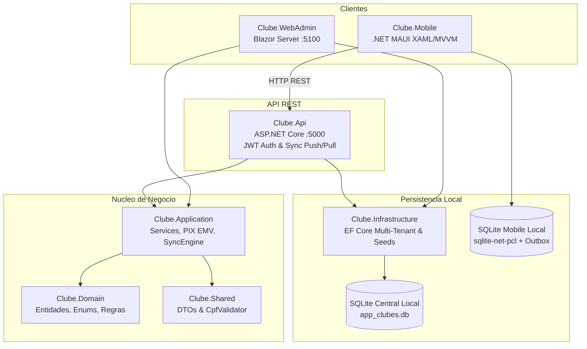

# ARCHITECTURE.md — Arquitetura do Sistema Projeto Clubes

## 1. Visão Geral e Estilo Arquitetural

O **Projeto Clubes** utiliza **Clean Architecture** 100% em **C# (.NET 10)**, com banco de dados **SQLite local** (sem Docker) e três interfaces principais:
1. **ASP.NET Core Web API (`Clube.Api`)** — Porta local `http://localhost:5000`
2. **Painel Web Administrativo (`Clube.WebAdmin`, Blazor Server)** — Porta local `http://localhost:5100`
3. **Aplicativo Móvel Dedicado (`Clube.Mobile`, .NET MAUI XAML/MVVM)** — Offline-First para Windows Desktop e Android



---

## 2. Estrutura da Solution (`ProjetoClube.sln`)

```
ProjetoClube/
├── GEMINI.md
├── ARCHITECTURE.md
├── MEMORY.md
├── README.md
├── ProjetoClube.sln
├── src/
│   ├── Clube.Domain/           # Entidades, Enums, Regras de Domínio (sem dependências externas)
│   ├── Clube.Shared/           # DTOs, Contratos de API/Sync, Validador de CPF
│   ├── Clube.Application/      # Interfaces, Serviços de Negócio, PixPayloadGenerator, SyncService
│   ├── Clube.Infrastructure/   # ClubeDbContext (Global Query Filters), DbInitializer (Seeds), TokenService (JWT), BCrypt
│   ├── Clube.Api/              # Controllers REST, Middleware de Tenant via JWT, OpenAPI (porta 5000)
│   ├── Clube.WebAdmin/         # Blazor Server Interactive (SuperAdmin, Presidente, Tesoureiro) (porta 5100)
│   └── Clube.Mobile/           # .NET MAUI (Views XAML, ViewModels MVVM, LocalDatabaseService, MobileSyncService)
└── tests/
    ├── Clube.Domain.Tests/         # Testes unitários de entidades, voto, CPF, reservas
    ├── Clube.Application.Tests/    # Testes de multi-tenancy, conflito de reservas, PIX CRC16, Sync Push/Pull
    └── Clube.Api.IntegrationTests/ # Testes E2E HTTP com WebApplicationFactory e SQLite isolado
```

---

## 3. Modelo de Dados e Domínio (`Clube.Domain`)

### 3.1. Entidades Principais
- **`Clube`:** `Id` (Guid), `Nome`, `Sigla`, `Endereco`, `Bairro`, `Cidade`, `UF`, `Telefone`, `Email`, `ChavePix`, `TipoChavePix`, `ValorMensalidadePadrao`, `Ativo`, `DataCadastro`.
- **`Usuario`:** `Id`, `ClubeId` (`Guid?`, nulo para `SuperAdmin`), `Nome`, `CPF`, `Email`, `Telefone`, `SenhaHash` (BCrypt), `Perfil` (`SuperAdmin`, `Presidente`, `Tesoureiro`, `Associado`, `Dependente`, `Simpatizante`), `Ativo`.
- **`Associado`:** `Id`, `UsuarioId`, `ClubeId`, `TipoAssociado` (`SocioFundadorComVoto`, `SocioConvidadoSemVoto`, `Simpatizante`), `StatusAprovacao` (`Pendente`, `Aprovado`, `Rejeitado`), `DataNascimento`, `Sexo`, `EstadoCivil`, `Endereco`, `Bairro`, `Cidade`, `UF`, `Interesses` (Pesca, Caça, Comida, Bebida, Eventos...), `SocioTitularId` (opcional), `MotivoRejeicao`.
  - Método de domínio: `TemDireitoAVoto()` retorna `true` **somente** se `TipoAssociado == SocioFundadorComVoto && StatusAprovacao == Aprovado`.
- **`Dependente`:** `Id`, `AssociadoTitularId`, `UsuarioId`, `Nome`, `CPF`, `GrauParentesco` (`Conjuge`, `Filho`, `Outro`), `DataNascimento`.
- **`Evento`:** `Id`, `ClubeId`, `Titulo`, `Descricao`, `TipoEvento` (`AlmocoDiaDasMaes`, `JantarDiaDosPais`, `CafeDaTarde`, `FeijoadaBeneficente`, `Geral`), `PublicoAlvo` (`SomenteAssociados`, `AbertoAoPublico`, `Simpatizantes`), `DataInicio`, `DataFim`, `Local`, `ValorIngresso`, `RequerInscricao`, `Ativo`.
- **`InscricaoEvento`:** `Id`, `EventoId`, `AssociadoId`, `DataInscricao`, `QuantidadeAcompanhantes`, `Status` (`Confirmada`, `Cancelada`).
- **`Espaco`:** `Id`, `ClubeId`, `Nome` (ex.: "Salão Social Principal"), `Capacidade`, `Descricao`, `Ativo`.
- **`ReservaEspaco`:** `Id`, `EspacoId`, `ClubeId`, `AssociadoId`, `FinalidadeUso` (`Festa`, `Churrasco`, `Feijoada`, `Outro`), `DataHoraInicio`, `DataHoraFim`, `Status` (`PendenteAprovacao`, `Confirmada`, `Cancelada`, `Rejeitada`, `Conflito`, `RejeitadaPorConflito`), `Observacoes`, `CriadoOffline`, `SincronizadoEm`.
- **`Mensalidade`:** `Id`, `ClubeId`, `AssociadoId`, `Competencia` (`MM/AAAA`), `Valor`, `DataVencimento`, `DataPagamento`, `Status` (`Pendente`, `Paga`, `Atrasada`, `Isenta`), `CodigoPixCopiaECola`, `Observacoes`.
- **`SolicitacaoReclamacao`:** `Id`, `ClubeId`, `AssociadoId`, `Tipo` (`Solicitacao`, `Reclamacao`), `Assunto`, `Descricao`, `RespostaDiretoria`, `Status` (`Aberta`, `EmAnalise`, `Respondida`), `DataCriacao`, `DataResposta`.

---

## 4. Regras de Negócio Críticas

1. **Multi-Tenancy no EF Core:**
   - `ClubeDbContext` injeta `ITenantContext`.
   - `HasQueryFilter` garante que consultas de `Presidente`, `Tesoureiro` e `Associado` retornem apenas registros onde `ClubeId == _tenantContext.CurrentClubeId`.
   - `SuperAdmin` opera com `CurrentClubeId == null`.
2. **Motor de Reservas Contínuas e Conflitos:**
   - Valida `DataHoraFim > DataHoraInicio` (permitindo cruzar dias, ex.: Feijoada `31/10 08:00` até `01/11 18:00`).
   - Se uma nova reserva (ou sincronização offline) sobrepõe uma reserva `Confirmada`, retorna erro/status `Conflito`.
   - Se sobrepõe uma reserva `PendenteAprovacao`, ambas ficam pendentes com alerta visual para o Presidente decidir; ao aprovar uma, as concorrentes pendentes passam automaticamente para `RejeitadaPorConflito`.
3. **Gerador PIX EMV QRCPS-MPM (`PixPayloadGenerator`):**
   - Gera string padrão BACEN Copia-e-Cola contendo chave PIX do clube, nome do recebedor, cidade, valor formatado (`54`) e checksum **CRC16-CCITT** (`6304XXXX`).
4. **Offline-First e Outbox (`Clube.Mobile`):**
   - Leituras vêm do SQLite local (`LocalDatabaseService`).
   - Escritas sem conexão entram na tabela de Outbox (`PendenteSincronizacao`).
   - Quando online, `MobileSyncService` executa `POST /api/sync/push` e `GET /api/sync/pull`.
5. **Elegibilidade de Eventos e Mensalidades:**
   - Eventos `SomenteAssociados` bloqueiam inscrição de `Simpatizante` ou associados não aprovados.
   - Geração em lote de mensalidades cobra **apenas Sócios Titulares aprovados** (Fundadores e Convidados); Dependentes e Simpatizantes são isentos de mensalidade fixa.

---

## 5. Endpoints Principais (`Clube.Api`)

- `POST /api/auth/login` (retorna JWT com `sub`, `role`, `clubeId`, `associadoId`)
- `POST /api/auth/registro-publico` (autocadastro via app com status `Pendente`)
- `GET/POST/PUT /api/clubes`
- `GET/PUT /api/associados`, `POST /api/associados/{id}/aprovar`, `POST /api/associados/{id}/rejeitar`
- `GET/POST /api/eventos`, `POST /api/eventos/{id}/inscrever`
- `GET/POST /api/espacos`
- `GET/POST /api/reservas`, `POST /api/reservas/{id}/aprovar`, `POST /api/reservas/{id}/rejeitar`
- `GET /api/mensalidades`, `POST /api/mensalidades/gerar-lote`, `POST /api/mensalidades/{id}/baixar`
- `GET/POST /api/solicitacoes`, `POST /api/solicitacoes/{id}/responder`
- `POST /api/sync/push`, `GET /api/sync/pull`

---

## 6. Seed Padrão de Demonstração (`DbInitializer`)

- **Clubes iniciais:** `Rotary Foz Ponte` (Foz do Iguaçu/PR) e `Iate Clube Guaíra` (Guaíra/PR).
- **Perfis iniciais:**
  - SuperAdmin (`000.000.000-00` / `Admin@123`)
  - Presidente Carlos Kaneko (`111.111.111-11` / `User@123`)
  - Tesoureiro (`222.222.222-22` / `User@123`)
  - Sócio Fundador com voto (`333.333.333-33` / `User@123`)
  - Sócio Convidado sem voto (`444.444.444-44` / `User@123`)
  - Simpatizante (`555.555.555-55` / `User@123`)
  - Presidente Guaíra (`666.666.666-66` / `User@123`)
